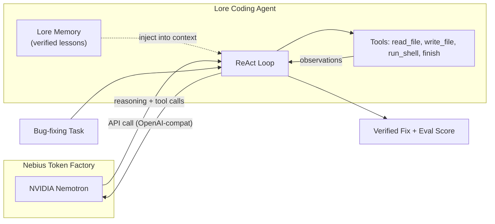

# Lore — Verified Procedural Knowledge for AI Agents

> 4 verified lessons · 2 draft · v0.2.0 CLI · MCP server included

[](https://github.com/Soulfullmens/lore/releases/tag/v0.2.0)
[](https://soulfullmens.github.io/lore/)
[](LICENSE)
[](LICENSE-CORPUS)
[](https://build.nvidia.com/)
[](https://studio.nebius.com/)

---

## Nebius x NVIDIA Global AI Hackathon — Coding & Agentic Engineering Track

> **Submission period change:** Added a **Nebius Token Factory + NVIDIA Nemotron** backend for Lore's coding agent so the full ReAct loop runs on NVIDIA open-source models served on Nebius infrastructure.

### What was built

Lore is a **coding agent with verified procedural memory**. During the hackathon submission period we integrated NVIDIA Nemotron as the reasoning engine, served through **Nebius Token Factory**. The agent:

1. **Reads** buggy Python source code via tool calls
2. **Reasons** about the root cause using Nemotron's chain-of-thought
3. **Generates patches** and applies them to the codebase
4. **Runs test suites** to verify fixes pass
5. **Optionally injects** verified Lore lessons (procedural knowledge) to handle known gotchas

### Architecture — how Nemotron powers the agent



### How Nemotron is used

The Nemotron model powers **every LLM call** in the agent's ReAct loop:

| Agent Step | What Nemotron Does |
|---|---|
| **Read** | Decides which files to inspect via `read_file` / `list_dir` tool calls |
| **Reason** | Analyzes buggy code, identifies root cause (e.g. `asyncio.gather` detached siblings) |
| **Fix** | Generates corrected code and writes it via `write_file` tool calls |
| **Verify** | Runs `run_shell` to execute test suites, reads output, iterates if needed |
| **Learn** | When Lore lessons are injected, uses verified procedural knowledge to avoid known pitfalls |

### Nebius tools & services used

- **Nebius Token Factory** — serves NVIDIA Nemotron models via OpenAI-compatible API
- **OpenAI-compatible endpoint** — zero-dependency integration using Python stdlib `urllib` (no SDK needed)

### How to run

**Prerequisites:** Python 3.11+, `pip install -e memory` from the repo root.

#### Quick demo (single seed, ~2 min)

```powershell
$env:NEBIUS_API_KEY="your-nebius-api-key"
$env:LORE_LLM_BASE_URL="https://api.studio.nebius.com/v1/"
$env:LORE_MODEL="<Nemotron model ID from Nebius catalog>"
python memory/examples/run_nebius_nemotron.py
```

#### Full statistical evaluation (5 seeds)

```powershell
python memory/examples/run_nebius_nemotron.py --seeds 5
```

#### With Lore memory injection (lessons inform Nemotron's reasoning)

```powershell
python memory/examples/run_nebius_nemotron.py --with-memory --seeds 5
```

#### Filter to a specific task family

```powershell
python memory/examples/run_nebius_nemotron.py --family acme-stream
```

#### Bash / Linux

```bash
export NEBIUS_API_KEY="your-nebius-api-key"
export LORE_LLM_BASE_URL="https://api.studio.nebius.com/v1/"
export LORE_MODEL="<Nemotron model ID from Nebius catalog>"
python memory/examples/run_nebius_nemotron.py
```

### Feedback on Nebius Token Factory

> I couldn't activate Token Factory: card verification failed and no other payment method (UPI, etc.) was offered for India. The integration code is ready but untested on Nebius.

### License

Code is licensed under **Apache-2.0** ([`LICENSE`](LICENSE)). Corpus under **CC-BY-4.0** ([`LICENSE-CORPUS`](LICENSE-CORPUS)).

---

**Lore** is a research corpus of container-verified procedural knowledge ("lessons") with attached executable evals, paired with a pre-registered empirical study investigating the limits of in-context knowledge injection vs parametric memory in AI coding agents.

> 📄 **Featured Research Paper:** Read the full pre-registered empirical paper in [`experiments/proof-of-use/PAPER.md`](experiments/proof-of-use/PAPER.md) and the acceptance bar for lessons in [`QUALITY_BAR.md`](QUALITY_BAR.md).

---

## 🔬 Empirical Study: Limits of In-Context Knowledge Injection

We pre-registered an experimental protocol ([`PROTOCOL.md`](experiments/proof-of-use/PROTOCOL.md), §3 locked in git at commit `403e5d3` before any trial ran) and built a decoupled dual-verification test harness to measure whether injecting verified procedural lessons into an AI agent's context improves bug-resolution performance versus an unassisted baseline.

### Key Empirical Findings (`gemini-3.1-flash-lite`, temp = 0.0)

18 pre-registered trials across 3 Python `asyncio` gotchas — control (symptom + code) vs treatment (symptom + code + verified lesson):

| Bug | Gotcha | Control | Treatment | Result |
| :--- | :--- | :---: | :---: | :--- |
| `0002` | `asyncio.gather` detached siblings | **3 / 3** | **0 / 3** | Negative lift (harm) |
| `0005` | Async-generator `aclose()` cleanup | **3 / 3** | **3 / 3** | Null (redundant) |
| `0006` | Default `run_in_executor` pool starvation | **3 / 3** | **3 / 3** | Null (redundant) |

Control solved **9/9 (100%)** at 1.00 mean turns; treatment solved **6/9** at 2.67 mean turns. Because control already solved every bug cold, this suite has **no headroom to detect positive lift** — it can only measure whether a lesson *harms* tasks the model already handles. On `0002`, a prescriptive "use `TaskGroup`" lesson overrode the correct context-sensitive default (`return_exceptions=True`) and broke 100% of treatment runs. Whether lessons *help* on bugs the model fails cold is untested here and is the central open question.

*Full methodology, harness design, and limitations: [`PAPER.md`](experiments/proof-of-use/PAPER.md) and [`RESULTS.md`](experiments/proof-of-use/RESULTS.md).*

---

## 🛠️ Platform Overview (`v0.2.0`)

Lore provides a CLI and verification engine for creating, validating, and continuously testing executable procedural knowledge artifacts:

- **Schema & Token Budgets**: Enforces maximum token limits (summary ≤ 60, body ≤ 900), JSON key uniqueness, and prompt-injection safety guards (`lore static-check`).
- **Containerized Dual Verification**: Re-runs positive and negative evals inside isolated, unnetworked Docker containers (`lore verify --stamp`).
- **Audit Receipts**: Emits JSON audit receipts into `receipts/` — stamped with the commit hash, timestamp, environment, and per-variant verdicts — recording that both the positive and negative evals ran against a real runtime. (Cryptographic `ed25519` signing is planned for v1; receipts are currently unsigned.)
- **Agent-SEO Static Site**: Builds symptom-first HTML, raw `.md` mirrors, `llms.txt`, and `sitemap.xml`, auto-deployed to GitHub Pages via GitHub Actions ([`soulfullmens.github.io/lore`](https://soulfullmens.github.io/lore/)).

---

## 🚀 Quickstart

### 1. Install CLI & Verifier
```bash
pip install -e verifier
```
*(A built distribution `lore-commons` is produced under `verifier/dist/`; it is not yet published to PyPI.)*

### 2. Run Static Validation
```bash
lore static-check lessons/python-async/asyncio-gather-detached-siblings-0002.json
```

### 3. Run Container Verification & Stamp Audit Receipt
*(Requires Docker Desktop running)*
```bash
lore verify lessons/python-async/asyncio-gather-detached-siblings-0002.json --stamp
```

---

## 📂 Repository Structure

```
├── lessons/                 # Lesson JSON artifacts (verified + draft)
├── receipts/                # Audit receipts emitted by `lore verify --stamp`
├── mcp-server/              # MCP server exposing verified lessons to agents (lore_search / lore_get)
├── memory/
│   ├── examples/
│   │   ├── run_nebius_nemotron.py  # ⬅ Hackathon: Nemotron on Nebius Token Factory
│   │   ├── run_baseline.py         # Phase 0 baseline with any LLM
│   │   └── run_phase1_comparison.py # Baseline vs memory comparison
│   ├── src/lore_memory/
│   │   ├── agent/               # ReActAgent, LLM clients, tools, prompts
│   │   ├── backends/            # Memory backends (null, episodic, consolidating)
│   │   ├── eval/                # Harness, grading, ablation
│   │   └── tasks/               # Bug-fixing task definitions
│   └── tasks/                   # Task YAML + buggy code + solutions
├── site/                    # Agent-SEO static site generator
├── verifier/                # Core Python package (`lore` CLI, verifier, static-checks)
├── experiments/proof-of-use/
│   ├── PROTOCOL.md          # Pre-registered study protocol (§3 locked in git)
│   ├── PAPER.md             # Empirical research paper
│   └── RESULTS.md           # Trial summary and empirical breakdown
└── SPEC.md                  # Lore registry specification v0.2
```

---

## 📜 License

Code (the `verifier` package, harness, and site generator) is licensed under **Apache-2.0** ([`LICENSE`](LICENSE)). The lesson corpus (`lessons/`) is licensed under **CC-BY-4.0** ([`LICENSE-CORPUS`](LICENSE-CORPUS)).

---

## 📄 Citation

If referencing the empirical study or using the dual-verification harness in your research:

```bibtex
@misc{lore2026knowledgeinjection,
  title  = {The Limits of In-Context Procedural Knowledge Injection for AI Coding Agents: A Pre-Registered Pilot},
  author = {Soulfullmens},
  year   = {2026},
  howpublished = {\url{https://github.com/Soulfullmens/lore}},
  note   = {GitHub repository}
}
```


